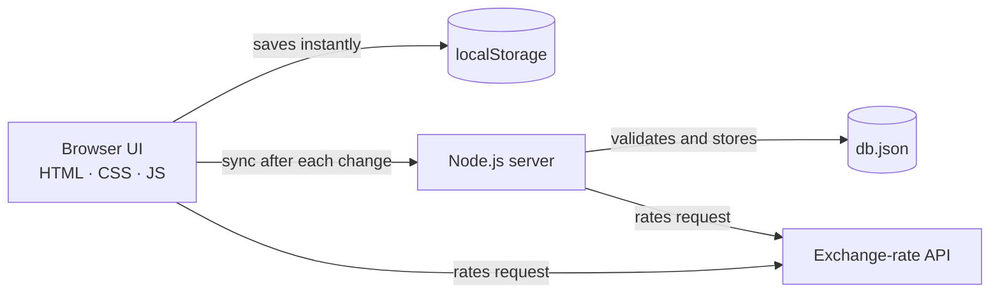

<div align="center">


<br>

**A fast, clean expense tracker with multi-currency support, budgets, charts and optional account sync.**

<br>


[**Live demo**](https://YOUR-USERNAME.github.io/expense-tracker/) &nbsp;·&nbsp; [Features](#-features) &nbsp;·&nbsp; [Quick start](#-quick-start) &nbsp;·&nbsp; [How it works](#-how-it-works) &nbsp;·&nbsp; [Roadmap](#-roadmap)

</div>

<br>

<div align="center">
  <picture>
    <source media="(prefers-color-scheme: dark)" srcset="assets/screenshot-dark.png">
    
  </picture>
</div>

<br>

## ✨ Features

| | Feature | What it does |
|---|---|---|
| 💸 | **Fast logging** | Add an expense in seconds: description, amount, date, category and currency |
| 📊 | **Monthly dashboard** | Big running total with a colour-coded category breakdown |
| 📈 | **6-month trend** | Spending chart across six months. Click a bar to jump to that month |
| 🎯 | **Budgets** | Set a budget per month and see what is left or how far over you are |
| 🌍 | **Multi-currency** | Enter expenses in ₦, $, € or £ and view everything in your chosen currency |
| ✏️ | **Edit and delete** | Fix mistakes in place, with no need to delete and re-add |
| 📤 | **CSV export** | Download all your expenses for Excel or Google Sheets |
| 🔐 | **Accounts and sync** | Sign up, log in and pick up your data on any device |
| 🌙 | **Dark mode** | Follows your system theme automatically |
| 📱 | **Responsive** | Works on phones, tablets and desktops |

<details>
<summary><b>📱 See it on mobile</b></summary>
<br>
<div align="center">
  
</div>
</details>

<br>

## 🚀 Quick start

<details open>
<summary><b>Option 1: no setup (offline mode)</b></summary>

<br>

Open `index.html` in any modern browser. Your data is saved in the browser with `localStorage`.

</details>

<details>
<summary><b>Option 2: with accounts and sync</b></summary>

<br>

You need [Node.js](https://nodejs.org) 16 or newer. There is nothing to install because the server uses only built-in Node modules.

```bash
git clone https://github.com/YOUR-USERNAME/expense-tracker.git
cd expense-tracker
npm start
```

Then open **http://localhost:3000** and click **Sign in**.

</details>

<details>
<summary><b>Option 3: host the offline version on GitHub Pages</b></summary>

<br>

1. Push the project to GitHub
2. Go to **Settings → Pages**
3. Choose **Deploy from a branch**, select `main` and the `/ (root)` folder, then save

Your demo goes live at `https://YOUR-USERNAME.github.io/expense-tracker/`. GitHub Pages cannot run the Node server, so sign-in is only available when you run the project yourself.

</details>

<br>

## 🧠 How it works



<details>
<summary><b>💱 Currency conversion</b></summary>

<br>

Every expense stores the amount and the currency it was entered in, so your original numbers never change. When you switch the display currency, totals, charts and budgets are converted using exchange rates. Live rates are fetched and cached for 12 hours. If they cannot load, the app falls back to approximate built-in rates and tells you so.

</details>

<details>
<summary><b>🔐 Authentication and sync</b></summary>

<br>

- Passwords are hashed with **scrypt** and a per-user salt
- Sessions use **HMAC-signed tokens** that expire after 7 days
- Login and sign-up are **rate limited** per IP
- All incoming data is **validated server-side** before it is saved
- **Logging in** loads your account data and jumps to a month that has expenses
- **Logging out** saves your latest changes, then clears the data from that device

</details>

<details>
<summary><b>🔌 REST API</b></summary>

<br>

| Method | Route | Description |
|---|---|---|
| `POST` | `/api/register` | Create an account with `{ email, password }` and receive a token |
| `POST` | `/api/login` | Log in and receive a token |
| `GET` | `/api/data` | Get the signed-in user's data (Bearer token) |
| `PUT` | `/api/data` | Replace the user's data (validated) |

</details>

<details>
<summary><b>🗂️ Project structure</b></summary>

<br>

```
expense-tracker/
├── index.html          # app markup
├── css/style.css       # styling, theming and responsive layout
├── js/app.js           # app logic: state, rendering, currency, sync
├── server/server.js    # static files, REST API and JSON storage
├── assets/             # banner and screenshots
├── package.json
└── README.md
```

</details>

<details>
<summary><b>🛠️ Tech stack</b></summary>

<br>

| Layer | Tools |
|---|---|
| Front end | Vanilla HTML5, CSS3 (custom properties, grid, dark mode), JavaScript (ES5-compatible) |
| Back end | Node.js with `http`, `crypto` and `fs`, and no dependencies |
| Storage | `localStorage` in the browser, a JSON file on the server |
| Tooling | Git, GitHub Pages |

</details>

<br>

## 🗺️ Roadmap

- [x] Add, edit and delete expenses
- [x] Monthly totals and category breakdown
- [x] Six-month trend chart
- [x] Budgets with progress indicator
- [x] CSV export
- [x] Multi-currency with live rates
- [x] Accounts and cross-device sync
- [ ] Recurring expenses
- [ ] Per-category budgets
- [ ] SQLite or PostgreSQL storage
- [ ] Rebuild the front end in React

<br>

## 💡 What I learned

- Designing a data model that stays correct when rates change, by storing the original amount and currency
- Building token-based authentication from scratch with Node's `crypto` module
- Keeping a UI in sync between local storage and a server without overwriting unsaved changes
- Testing a full flow end to end in a headless browser

<br>

## 🤝 Contributing

Ideas and pull requests are welcome. Fork the repo, create a branch, and open a PR.

## 📄 License

Released under the [MIT License](LICENSE).

<br>

<div align="center">

Built by **Daniel Abiola(https://github.com/dannyabby3105)**. If this helped you, consider giving it a ⭐

</div>
